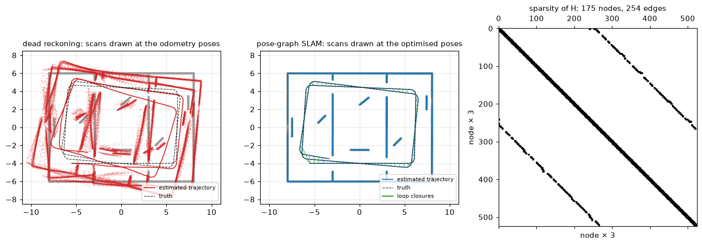

# 10 · Pose-based SLAM with scan matching

Feature-based SLAM (chapter 9) needs a detector that turns raw readings into point landmarks, and it pays $O(n^2)$ per
update for a dense covariance. A 2-D lidar gives something richer: a whole profile of the surroundings per scan. In
**pose-based SLAM** the state is the trajectory alone. Each keyframe pose carries its raw scan; **scan matching**
turns two scans into a measurement of the relative pose between them; and the trajectory is found by least squares
over all those measurements. The map is not estimated at all: it is the scans drawn at the estimated poses.

Code: [`scan_matching.hpp`](../cpp/include/state_estimation/scan_matching.hpp),
[`pose_graph.hpp`](../cpp/include/state_estimation/pose_graph.hpp) ·
Tests: [`test_scan_matching.cpp`](../cpp/tests/test_scan_matching.cpp),
[`test_pose_graph.cpp`](../cpp/tests/test_pose_graph.cpp) ·
Notebook: [`10_pose_graph_slam.ipynb`](../2_notebooks/solutions/10_pose_graph_slam.ipynb)

## 10.1 The scan-matching problem

A **reference** scan $\{q_j\}$ was taken at pose $x_a$ and a **current** scan $\{p_i\}$ at pose $x_b$, both as points in
their own sensor frames. If $x = \ominus x_a \oplus x_b$ is the pose of the current frame seen from the reference
frame, a point of the current scan and the point of the reference scan on the same surface satisfy

$$
q_{c(i)} \approx x \boxplus p_i = t + R(\theta)\,p_i, \tag{10.1}
$$

with $c(i)$ the unknown correspondence. Scan matching finds $x$ and $c$ together by minimising a sum of squared
residuals; with the pairs fixed, the point-to-point version is

$$
x^\star = \arg\min_x \sum_i \lVert x\boxplus p_i - q_{c(i)}\rVert^2. \tag{10.2}
$$

## 10.2 Point-to-point ICP

**Closed form for known pairs.** Subtract the centroids,

$$
\bar p = \frac1N\sum_i p_i,\qquad \bar q = \frac1N\sum_i q_{c(i)},\qquad p_i' = p_i-\bar p,\quad q_i' = q_{c(i)}-\bar q. \tag{10.3}
$$

For any rotation the best translation is $t = \bar q - R\bar p$, which leaves $\sum_i\lVert Rp_i' - q_i'\rVert^2$. Expanding,
only $-2\sum_i q_i'^TRp_i'$ depends on $\theta$; with the cross-covariance

$$
S = \sum_i p_i'\,q_i'^T, \tag{10.4}
$$

$\sum_i q_i'^TRp_i' = \cos\theta\,(S_{xx}+S_{yy}) + \sin\theta\,(S_{xy}-S_{yx})$, which is largest at

$$
\theta^\star = \operatorname{atan2}(S_{xy}-S_{yx},\; S_{xx}+S_{yy}),\qquad t^\star = \bar q - R(\theta^\star)\,\bar p. \tag{10.5}
$$

This is the planar case of the SVD solution of Arun, Huang and Blostein (1987); in 2-D it needs no decomposition.

**ICP** (Besl and McKay, 1992) alternates the two sub-problems: pair every current point, moved by the current guess,
with its nearest reference point (rejecting pairs farther than $d_\text{max}$), then solve (10.5) for those pairs. Each
step cannot increase the cost, so ICP converges — to the **nearest** local minimum. It needs an initial guess
(odometry) within roughly half the spacing of the structures in the scan.

Point-to-point has a built-in flaw: the two scans sample a wall at *different* points, so even at the true pose each
residual is up to half the beam spacing long. The cost is never zero, and near the optimum the pairs keep sliding
along the wall, which makes the convergence slow.

## 10.3 Point-to-line ICP

Measure only the distance **across** the surface. With $n_j$ the unit normal of the reference scan at $q_j$,

$$
r_i(x) = n_{c(i)}^T\bigl(x\boxplus p_i - q_{c(i)}\bigr). \tag{10.6}
$$

A point may slide along the wall at no cost, which is exactly the ambiguity of sampling. The residual is nonlinear in
$\theta$ only; its gradient is

$$
J_i = \frac{\partial r_i}{\partial x} = \begin{bmatrix} n_x & n_y & n^T R'(\theta)\,p_i\end{bmatrix},\qquad
R'(\theta) = \begin{bmatrix}-\sin\theta & -\cos\theta\\ \cos\theta & -\sin\theta\end{bmatrix}, \tag{10.7}
$$

and a Gauss–Newton step solves the $3\times3$ normal equations

$$
\Bigl(\sum_i J_i^TJ_i\Bigr)\,\delta = -\sum_i J_i^T r_i, \tag{10.8}
$$

$$
x \leftarrow x + \delta. \tag{10.9}
$$

The pairs are re-computed at every step. Point-to-line converges in far fewer iterations than point-to-point (Chen and
Medioni, 1992; Censi, 2008); the tests check it on the same pair of scans.

**Normals.** The normal at $q_j$ is the eigenvector of the smallest eigenvalue of the scatter matrix of its $k$ nearest
neighbours, turned to face the sensor. The neighbours must lie on the same surface: at the sparse far end of a scan the
$k$ nearest points can reach across to another wall and tilt the normal. The library therefore uses only neighbours
within a radius, and a point with fewer than three gets no normal and no pair.

**Stopping.** With nearest-neighbour pairing a point can flip between two neighbours from one iteration to the next,
and the step may never fall below a tight tolerance. The iteration has reached its fixed point when the set of pairs
no longer changes and the step is already small.

## 10.4 The uncertainty of a match

Around the optimum the cost is quadratic, and treating the residuals as independent with a common variance gives
the usual least-squares covariance

$$
\Sigma_x \approx s^2\Bigl(\sum_i J_i^TJ_i\Bigr)^{-1},\qquad s^2 = \frac{\sum_i r_i^2}{N - 3}. \tag{10.10}
$$

Two things follow from it:

- **Degeneracy.** In a corridor of straight parallel walls every normal is across the corridor, so the first column of
  every $J_i$ is zero and $J^TJ$ has a zero eigenvalue whose eigenvector is the corridor axis: the scans say
  nothing about motion along it. The tests show the exact zero eigenvalue for noise-free scans. With noisy ranges the
  normals tilt at random and invent a little information, so the reported along-corridor variance is large but
  finite — and the estimate along the corridor is still driven by noise.
- **Optimism.** (10.10) ignores the uncertainty of the correspondences, of the normals and of the sensor model, so it is
  optimistic (Bengtsson and Baerveldt, 2003; Censi, 2007). The tests compare it with 200 Monte Carlo matches in a
  structured room and require an average NEES between 1 and 8 (3 is consistent). The worst case is a **wrong local
  minimum**: a match that converged to the wrong place reports a small covariance, so it must be caught by other means
  (section 10.8).

## 10.5 The pose graph

A **pose graph** has one node per keyframe pose $x_0, \dots, x_T$ and one edge per relative-pose measurement $z_{ij}$
(odometry or a scan match between keyframes $i$ and $j$), with information matrix $\Omega_{ij}$. The **error** of an
edge compares the measurement with the relative pose the nodes imply:

$$
e_{ij} = \ominus z_{ij}\oplus(\ominus x_i\oplus x_j)
= \begin{bmatrix} R_z^T\bigl(R_i^T(t_j - t_i) - t_z\bigr)\\ \operatorname{wrap}(\theta_j - \theta_i - \theta_z)\end{bmatrix}, \tag{10.11}
$$

with $R_i = R(\theta_i)$ and $R_z = R(\theta_z)$. It is zero when the nodes agree with the measurement. Its Jacobians with
respect to the two nodes are

$$
A_{ij} = \frac{\partial e_{ij}}{\partial x_i} = \begin{bmatrix} -R_z^TR_i^T & R_z^T\,\dfrac{dR_i^T}{d\theta_i}(t_j - t_i)\\ 0\;\;0 & -1\end{bmatrix},\qquad
B_{ij} = \frac{\partial e_{ij}}{\partial x_j} = \begin{bmatrix} R_z^TR_i^T & 0\\ 0\;\;0 & 1\end{bmatrix}. \tag{10.12}
$$

## 10.6 Optimisation by Gauss–Newton

With independent Gaussian edge errors, the maximum-likelihood trajectory minimises

$$
F(x) = \sum_{\langle i,j\rangle} e_{ij}^T\,\Omega_{ij}\,e_{ij}. \tag{10.13}
$$

Linearising each error around the current estimate, $e_{ij}(x+\delta) \approx e_{ij} + A_{ij}\delta_i + B_{ij}\delta_j$, turns
(10.13) into a quadratic in $\delta$ whose minimum solves

$$
H\,\delta = -b, \tag{10.14}
$$

where every edge adds four blocks to $H$ and two to $b$:

$$
H_{ii} \mathrel{+}= A^T\Omega A,\quad H_{ij} \mathrel{+}= A^T\Omega B,\quad H_{ji} \mathrel{+}= B^T\Omega A,\quad H_{jj} \mathrel{+}= B^T\Omega B,\qquad
b_i \mathrel{+}= A^T\Omega e,\quad b_j \mathrel{+}= B^T\Omega e. \tag{10.15}
$$

$$
x \leftarrow x + \delta, \quad\text{repeated until } \lVert\delta\rVert_\infty \text{ is negligible.} \tag{10.16}
$$

- **Gauge.** The errors depend only on relative poses, so moving the whole graph rigidly changes nothing and $H$ is
  singular by three. Fixing node 0 — the map frame is the first keyframe — removes the freedom.
- **Sparsity.** $H$ has a non-zero block only on the diagonal and where an edge links two nodes: a band from the
  odometry chain plus a few off-diagonal blocks from loop closures. A sparse Cholesky factorisation solves (10.14) in
  time roughly linear in the number of nodes; the library uses Eigen's `SimplicialLDLT`.
- **Re-linearisation.** Unlike the EKF of chapter 9, which fixes each linearisation once and for all, every Gauss–Newton
  iteration re-linearises *all* edges at the current estimate. That is what makes the optimisation approach consistent
  where EKF SLAM is not, and what lets a loop closure bend the whole trajectory into place.

## 10.7 Covariances

The covariance of the estimate is $H^{-1}$ at the optimum (node 0 removed); the marginal of one node is its $3\times3$
diagonal block, obtained by solving $H X = E_i$ for the three columns of node $i$ instead of inverting $H$.

**Information of an edge.** $\Omega_{ij}$ is the inverse covariance of the *error* (10.11), not of the measurement.
The error depends on the measurement through $J_z = \partial e/\partial z = -\operatorname{diag}(R_z^T, 1)$ at $e = 0$, so

$$
\Omega_{ij} = \bigl(J_z\,\Sigma_z\,J_z^T\bigr)^{-1}. \tag{10.17}
$$

Using $\Sigma_z^{-1}$ directly is right only when $\Sigma_z$ is rotationally symmetric in $x$–$y$. The tests show that with
(10.17) an odometry chain reproduces dead reckoning exactly — the optimum is the composition of the measurements and the
marginal of the last node is the dead-reckoning covariance $FPF^T + WQW^T$ of chapter 2 — and that with $\Sigma_z^{-1}$ it
does not.

## 10.8 The front end: building the graph

The optimiser (the *back end*) trusts every edge. Getting the edges right is the job of the *front end*, and most
failures of pose-graph SLAM start there. `PoseGraphSlam` processes keyframes as they arrive:

1. **Odometry edge.** Match the new scan against the previous keyframe's, starting from the wheel-odometry
   displacement $u$ with covariance $\Sigma_u$. Keep the match only if it is good (small rmse) **and** agrees with
   odometry: $d^T(\Sigma_u + \Sigma_x)^{-1}d < \chi^2_3(0.999)$ with $d = x - u$. A wrong local minimum of ICP reports a
   small covariance and would otherwise bend the whole map; the gate catches it. A rejected match falls back to the
   odometry edge itself.
2. **Loop-closure search.** Look for the nearest keyframe at least a few keyframes back whose estimated position is
   within a radius of the new one. The current estimate has drifted, so the radius is widened by $3\sigma$ of the new
   node's marginal position covariance — without that, once the drift exceeds the radius no loop is ever found.
3. **Loop-closure match.** ICP from the relative pose the graph predicts, first with a pairing distance that covers the
   uncertainty, then refined with the normal one; accept only a converged, low-rmse match with enough pairs.
4. **Optimise** after each accepted closure, so that the next search starts from a corrected trajectory.

**Checking the result.** At the optimum, $F(x)$ is approximately $\chi^2$-distributed with
$\text{dof} = 3\,(\#\text{edges}) - 3\,(\#\text{nodes} - 1)$ degrees of freedom, so $F > \chi^2_\text{dof}(0.999)$
says the graph contains a wrong edge. A single false loop closure is spread over all the edges of its loop, so its own
term $e^T\Omega e$ need not exceed a per-edge gate; the total is the reliable test. The edge with the largest term
is the first suspect. Deleting edges one at a time is fine for one outlier; with many (an aliased environment, a
drifted estimate searched with a fixed radius) a greedy deletion also throws away good edges, and robust kernels or
switchable constraints (Sünderhauf and Protzel, 2012) are the better tool. The notebook shows both cases.

## 10.9 Factor graphs and libraries

A pose graph is the simplest **factor graph**: variables (poses) and factors (one per measurement) whose negative
log-likelihoods are summed. Adding other factors — a GNSS fix on one node, a landmark seen from several nodes, an IMU
pre-integrated between keyframes — keeps the same Gauss–Newton machinery. Production systems use libraries for it:
GTSAM (factor graphs with incremental iSAM2), g2o and Ceres. The notebook solves the same graph with GTSAM, if it is
installed, and compares the results.

Two relatives of this chapter are worth knowing: the **pose-based (delayed-state) EKF**, which keeps past poses in an
EKF state and updates it with scan matches (used in [pekf-slam-icp](https://github.com/Rudip1/pekf-slam-icp)), and
Levenberg–Marquardt, which damps (10.14) as $(H + \lambda I)\delta = -b$ when Gauss–Newton steps from a poor initial
guess overshoot.

## Algorithm summary — pose-graph SLAM with a lidar

1. Start the graph with node $x_0$ (fixed) and its scan.
2. For each new keyframe: match its scan against the previous one from the odometry guess (point-to-line ICP,
   (10.6)–(10.9)); keep the match if its rmse is small and it passes the odometry gate, else use odometry. Add the node
   and the edge with $\Omega$ from (10.10) and (10.17).
3. Search the nearest old keyframe within $r + 3\sigma$; match; accept a good match as a loop-closure edge.
4. After each closure, optimise (10.13)–(10.16) with node 0 fixed.
5. Check $F$ against $\chi^2_\text{dof}(0.999)$; if it fails, look at the largest edge terms.
6. Draw the map: every scan transformed by its keyframe pose.

## Common mistakes

- Using point-to-point ICP where point-to-line converges in a fraction of the iterations.
- Estimating normals from neighbours that belong to another surface.
- Trusting the covariance of a match blindly: it is optimistic, and a wrong local minimum reports a small one.
- Passing $\Sigma_z^{-1}$ as the edge information instead of (10.17).
- Forgetting the gauge: $H$ is singular unless one node is fixed.
- Searching for loop closures within a fixed radius of a drifted estimate.
- Checking individual edges for outliers when only the total $\chi^2$ can see a false closure spread over a loop.

## References

- K. S. Arun, T. S. Huang, S. D. Blostein, "Least-squares fitting of two 3-D point sets", *IEEE TPAMI* 9(5), 1987.
- P. J. Besl, N. D. McKay, "A method for registration of 3-D shapes", *IEEE TPAMI* 14(2), 1992.
- Y. Chen, G. Medioni, "Object modelling by registration of multiple range images", *Image and Vision Computing*
  10(3), 1992.
- F. Lu, E. Milios, "Globally consistent range scan alignment for environment mapping", *Autonomous Robots* 4, 1997.
- O. Bengtsson, A.-J. Baerveldt, "Robot localization based on scan-matching — estimating the covariance matrix for
  the IDC algorithm", *Robotics and Autonomous Systems* 44, 2003.
- A. Censi, "An accurate closed-form estimate of ICP's covariance", *ICRA*, 2007.
- A. Censi, "An ICP variant using a point-to-line metric", *ICRA*, 2008.
- G. Grisetti, R. Kümmerle, C. Stachniss, W. Burgard, "A tutorial on graph-based SLAM", *IEEE Intelligent
  Transportation Systems Magazine* 2(4), 2010.
- N. Sünderhauf, P. Protzel, "Switchable constraints for robust pose graph SLAM", *IROS*, 2012.
- F. Dellaert, M. Kaess, "Factor graphs for robot perception", *Foundations and Trends in Robotics* 6(1–2), 2017.
- S. Thrun, W. Burgard, D. Fox, *Probabilistic Robotics*, MIT Press, 2005 — ch. 11 (GraphSLAM).
