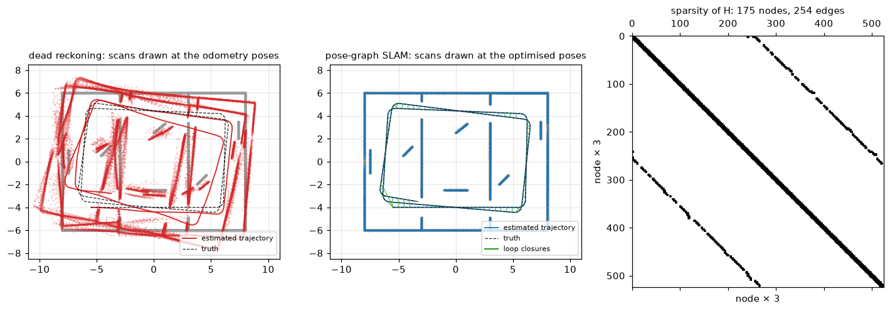

# learn-state-estimation

Probabilistic state estimation and SLAM for mobile robots: probability, motion and measurement models, the
Bayes, Kalman, extended Kalman and particle filters, data association, feature-based EKF SLAM and pose-graph SLAM
with scan matching. Each chapter has a theory text, a C++17 library (`state_estimation`) tested against independent
references, and Python notebooks that call it.



*Chapter 10: scans drawn at the dead-reckoning poses and at the optimised poses of the pose graph, and the sparsity of its information matrix.*

## Chapters

| # | Chapter | Theory | Code | Notebook |
|---|---------|--------|------|----------|
| 1 | Probability for robotics | [text](1_theory/01_probability.md) | [gaussian.hpp](cpp/include/state_estimation/gaussian.hpp) | [exercises](2_notebooks/exercises/01_probability.ipynb) · [solutions](2_notebooks/solutions/01_probability.ipynb) |
| 2 | Motion models | [text](1_theory/02_motion_models.md) | [motion_models.hpp](cpp/include/state_estimation/motion_models.hpp) | [exercises](2_notebooks/exercises/02_motion_models.ipynb) · [solutions](2_notebooks/solutions/02_motion_models.ipynb) |
| 3 | Measurement models | [text](1_theory/03_measurement_models.md) | [measurement_models.hpp](cpp/include/state_estimation/measurement_models.hpp) | [exercises](2_notebooks/exercises/03_measurement_models.ipynb) · [solutions](2_notebooks/solutions/03_measurement_models.ipynb) |
| 4 | The Bayes filter and grid localization | [text](1_theory/04_bayes_filter.md) | [histogram_filter.hpp](cpp/include/state_estimation/histogram_filter.hpp) | [exercises](2_notebooks/exercises/04_bayes_filter.ipynb) · [solutions](2_notebooks/solutions/04_bayes_filter.ipynb) |
| 5 | The Kalman filter | [text](1_theory/05_kalman_filter.md) | [kalman_filter.hpp](cpp/include/state_estimation/kalman_filter.hpp) | [exercises](2_notebooks/exercises/05_kalman_filter.ipynb) · [solutions](2_notebooks/solutions/05_kalman_filter.ipynb) |
| 6 | The EKF | [text](1_theory/06_ekf_localization.md) | [ekf.hpp](cpp/include/state_estimation/ekf.hpp) | [exercises](2_notebooks/exercises/06_ekf_localization.ipynb) · [solutions](2_notebooks/solutions/06_ekf_localization.ipynb) |
| 7 | The particle filter | [text](1_theory/07_particle_filter.md) | [particle_filter.hpp](cpp/include/state_estimation/particle_filter.hpp) | [exercises](2_notebooks/exercises/07_particle_filter.ipynb) · [solutions](2_notebooks/solutions/07_particle_filter.ipynb) |
| 8 | Data association | [text](1_theory/08_data_association.md) | [data_association.hpp](cpp/include/state_estimation/data_association.hpp) | [exercises](2_notebooks/exercises/08_data_association.ipynb) · [solutions](2_notebooks/solutions/08_data_association.ipynb) |
| 9 | Feature-based EKF SLAM | [text](1_theory/09_ekf_slam.md) | [ekf_slam.hpp](cpp/include/state_estimation/ekf_slam.hpp) | [exercises](2_notebooks/exercises/09_ekf_slam.ipynb) · [solutions](2_notebooks/solutions/09_ekf_slam.ipynb) |
| 10 | Pose-graph SLAM with scan matching | [text](1_theory/10_pose_graph_slam.md) | [pose_graph.hpp](cpp/include/state_estimation/pose_graph.hpp) · [scan_matching.hpp](cpp/include/state_estimation/scan_matching.hpp) | [exercises](2_notebooks/exercises/10_pose_graph_slam.ipynb) · [solutions](2_notebooks/solutions/10_pose_graph_slam.ipynb) |

Notation is fixed once in [1_theory/00_notation.md](1_theory/00_notation.md).

## Quick start

```bash
sudo apt install build-essential cmake libeigen3-dev python3-venv
make test                                   # C++ library and Catch2 tests
python3 -m venv .venv && source .venv/bin/activate
pip install -e ".[notebooks]"               # builds the Python module state_estimation (pybind11)
```

Then open `2_notebooks/exercises/` in Jupyter or VS Code: cells marked ✏️ are exercises with a check below them,
cells marked 🔨 break an assumption on purpose. Each notebook also runs on Colab (its first cell installs the
module). Details are in [HOW_TO_RUN.md](HOW_TO_RUN.md).

## Layout

```
1_theory/      chapter texts and figures
2_notebooks/   exercises/ (to fill in) and solutions/ (executed)
cpp/           include/state_estimation, src, tests (Catch2)
python/        bindings and helpers of the Python module state_estimation
tools/         figure generator and notebook tooling
```

## Used in

* [pekf-slam-icp](https://github.com/Rudip1/pekf-slam-icp) — pose-based EKF SLAM with ICP scan matching in ROS 2, built on
  this library's C++ (chapters 2, 6, 8, 9 and 10).
* [robotics-learning](https://github.com/Rudip1/robotics-learning) — the umbrella of all learn-* modules.

## Licence

Code: Apache-2.0 ([LICENSE](LICENSE)). Theory texts and figures in `1_theory/`: CC BY 4.0.
